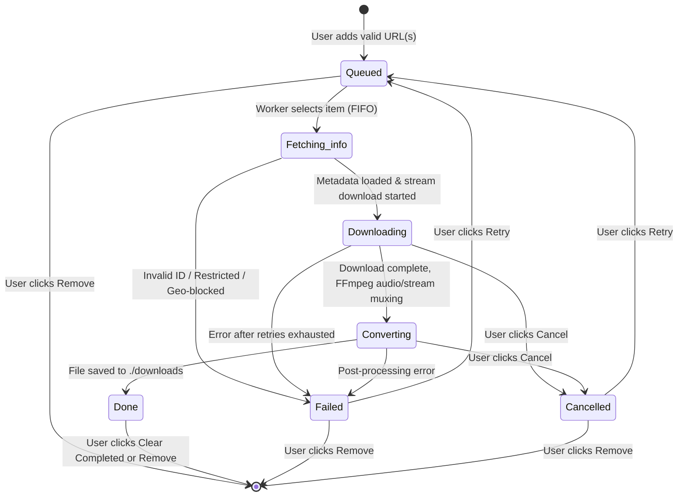

# ⚡ Queue Downloader

**Queue Downloader** is a web application designed to download YouTube videos sequentially one after another from an automated queue. Powered by **Node.js, Express, TypeScript, SQLite, yt-dlp, ffmpeg, React 19, and Tailwind CSS**.

---

## 🎯 Key Features

- **Sequential Download Queue**: Strictly processes **one item at a time**. When an item finishes (or fails), the next queued item starts automatically with zero clicks required.
- **Immediate Execution**: Adding a link to an empty queue starts the download immediately.
- **Continuous Enqueuing**: Paste links while a download is running; each link is safely appended to the end of the queue.
- **Multi-line Paste**: Paste multiple URLs at once (one per line) and have them queued in order.
- **Playlist Support**: Intelligently detects playlist URLs and prompts whether to enqueue the entire playlist in order or download only the single video.
- **Duplicate Prevention**: Detects videos already queued or downloaded, automatically skipping them and displaying a notification.
- **Formats & Quality Selection**:
  - Formats: **MP4 Video** or **MP3 Audio only**.
  - Video Qualities: **Best**, **1080p (Full HD)**, **720p (HD)**, **480p (SD)**, and **360p**.
- **Real-Time Progress Streaming**: Live download percentage, speed (MB/s), ETA, and postprocessing status streamed via **Server-Sent Events (SSE)** without polling.
- **Queue Persistence & Crash Recovery**: Persisted to SQLite (`node:sqlite`). If the server restarts or page refreshes, items in progress safely reset to `Queued` and resume automatically.
- **Non-Blocking Resilient Error Handling**: Videos that are private, deleted, age-restricted, or geo-blocked report a readable error and **never block the queue**.
- **Transient Network Retries**: Automatically retries transient network errors up to 2 times with backoff before marking Failed.
- **Item & Queue Controls**:
  - Per-item: **Cancel**, **Remove**, **Retry** (for failed/cancelled), and **Save file** (browser download).
  - Global: **Pause Queue**, **Resume Queue**, and **Clear Completed**.
- **System Health & Updater**:
  - Startup check verifies `yt-dlp` and `ffmpeg` are installed.
  - "Update yt-dlp" button to update `yt-dlp` whenever YouTube changes its internal player APIs.
- **Retention Auto-Cleanup**: Automatically prunes downloaded files older than *N* days (configurable via `.env`).
- **Modern Responsive UI**: Dark and light mode toggle, responsive design for desktop and mobile devices.

---

## 🏗️ Queue State Machine



---

## 📂 File Structure

```
/Users/anudeep/ytr/
├── .env                  # Live environment configuration
├── .env.example          # Environment configuration template
├── README.md             # Documentation and usage guide
├── package.json          # Monorepo scripts and dependencies
├── tsconfig.json         # Base TypeScript configuration
├── tsconfig.server.json  # Server build configuration
├── vite.config.ts        # Vite configuration with API proxy
├── tailwind.config.js    # Tailwind CSS configuration (dark mode support)
├── postcss.config.js     # PostCSS configuration
├── index.html            # Single page entry HTML
├── downloads/            # Destination directory for downloaded videos/audio
├── data/                 # SQLite database storage (queue.db)
├── src/
│   ├── shared/
│   │   └── types.ts      # Shared domain models and API contracts
│   ├── server/
│   │   ├── config.ts     # Environment variables and path resolution
│   │   ├── db.ts         # Persistent SQLite database via node:sqlite
│   │   ├── validator.ts  # Strict YouTube URL validation and ID extraction
│   │   ├── system.ts     # Tool checks, yt-dlp updater, retention auto-cleanup
│   │   ├── downloader.ts # yt-dlp process runner with safe spawn argument array
│   │   ├── queue.ts      # Queue state machine, single worker, retries, auto-advance
│   │   ├── routes.ts     # REST API routes and Server-Sent Events (SSE)
│   │   └── index.ts      # Express server entry point (localhost bound)
│   └── client/
│       ├── main.tsx      # React entry point
│       ├── App.tsx       # Root application layout
│       ├── index.css     # Tailwind CSS styles and custom scrollbars
│       ├── hooks/
│       │   ├── useTheme.ts   # Dark / light theme switcher
│       │   └── useSSE.ts     # Real-time SSE subscriber hook
│       └── components/
│           ├── Header.tsx        # Top navbar, queue status, pause/resume, theme switch
│           ├── SystemBanner.tsx  # Missing dependency banner & update yt-dlp modal
│           ├── UrlInput.tsx      # Input area (multi-line), format/quality selector, Add button
│           ├── PlaylistModal.tsx # Choice dialog for playlist URLs
│           ├── QueueList.tsx     # Queue list container with empty state
│           ├── QueueItemRow.tsx  # Item row: thumbnail, status badge, progress bar, actions
│           ├── Toast.tsx         # Toast notification container
│           └── Footer.tsx        # Disclaimer and compliance notice
└── tests/
    ├── validator.test.ts # Unit tests for URL validator & playlist detection
    └── queue.test.ts     # Unit tests for queue logic, ordering, auto-advance, retries
```

---

## 🛠️ Prerequisites

1. **Node.js**: v20+ recommended (Node.js 22+ or 26 has `node:sqlite` built in).
2. **yt-dlp**: Required for downloading video and audio streams.
3. **ffmpeg**: Required for audio conversion (MP3) and stream muxing.

### Installing Prerequisites (macOS):
```bash
brew install yt-dlp ffmpeg
```

### Installing Prerequisites (Linux / Debian / Ubuntu):
```bash
sudo apt-get update && sudo apt-get install -y ffmpeg
sudo wget https://github.com/yt-dlp/yt-dlp/releases/latest/download/yt-dlp -O /usr/local/bin/yt-dlp
sudo chmod a+rx /usr/local/bin/yt-dlp
```

---

## 🚀 Quickstart

1. **Install dependencies**:
   ```bash
   npm install
   ```

2. **Configure environment** (optional):
   ```bash
   cp .env.example .env
   ```
   Default `.env`:
   ```env
   PORT=3000
   HOST=127.0.0.1
   DOWNLOAD_DIR=./downloads
   DB_PATH=./data/queue.db
   RETENTION_DAYS=7
   ```

3. **Start Development Server**:
   ```bash
   npm run dev
   ```
   - Vite Client: `http://127.0.0.1:5173`
   - Express Backend: `http://127.0.0.1:3000`

4. **Build and Run Production Server**:
   ```bash
   npm run build
   npm start
   ```
   Opens on `http://127.0.0.1:3000`.

---

## 🧪 Running Unit Tests

Unit tests verify the URL validator, host injection guards, and the queue state machine:
```bash
npm test
```

Tests cover:
- Standard, shortened (`youtu.be`), Shorts, Embed, and Music YouTube URLs.
- Host whitelist enforcement (`youtube.com`, `youtu.be`, `music.youtube.com`) and spoofing protection.
- Playlist detection and parameter parsing.
- Strict single concurrency (1 item at a time).
- Queue ordering (FIFO).
- Auto-advancing after item completion.
- Auto-advancing after item failure (never blocking the queue).
- Pause and resume behavior.
- Cancelling in-progress downloads with child process cleanup.
- Manual retry mechanism for failed/cancelled items.

---

## 🔒 Security & Local Design

- **Safe Process Spawning**: `yt-dlp` and `ffmpeg` are spawned using argument arrays (`spawn('yt-dlp', args)`), completely avoiding shell string execution (`exec`) and eliminating command injection risks.
- **Strict Hostname Whitelist**: Only `youtube.com`, `youtu.be`, and `music.youtube.com` domains are permitted. Arbitrary hostnames or malicious URLs are rejected before processing.
- **Localhost Binding**: Configured to bind to `127.0.0.1` by default for local machine use.

---

## ⚖️ Legal Notice

> **Notice**: Personal tool meant to run locally on your own machine. Only download content you own, that is licensed for reuse, or that you have permission to download.

